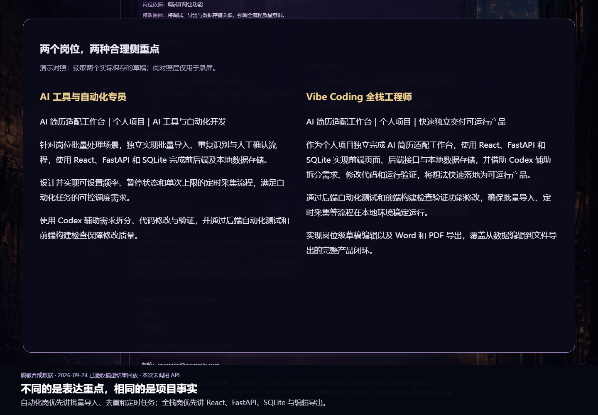

# 脱敏演示与复现

## 已录制视频

[下载 2 分 20 秒中文字幕演示（MP4，约 6.8 MB）](https://github.com/eazinyu-hub/resume-tailor-/raw/refs/heads/main/docs/demo/resume-tailor-demo.mp4)，无配音。下载后使用本机视频播放器打开，无需安装项目或配置 API Key。

如果浏览器直接播放，可右键“视频另存为”。备用入口：[视频文件页面](demo/resume-tailor-demo.mp4)，点击右上角 **Download raw file（下载）** 按钮；也可以下载仓库 ZIP，在 `docs/demo/resume-tailor-demo.mp4` 中查看。不要把文件页面不能预览误认为视频缺失。

录制日期：2026-10-10。使用两条合成岗位、示例简历和同一张合成事实卡。模型候选来自 2026-09-24 两次真实调用的已验收输出，视频全程标注回放；本次不调用 API。保存、岗位隔离、重新读取草稿和 Word/PDF 导出均经过实际后端处理。最后的并排对照是录屏注释层，不是应用已有功能。

录屏环境通过本地进程管道调用真实 FastAPI ASGI 应用，绕开录制沙箱的本地端口连接限制；页面来自真实前端构建产物。



## 重新录制（开发者可选）

日常使用不需要安装录屏依赖。需要重新录制时，在独立目录安装 Playwright 和浏览器：

```powershell
npm install --prefix work/demo-tools playwright
$env:PLAYWRIGHT_BROWSERS_PATH = "$PWD/work/demo-tools/browsers"
node work/demo-tools/node_modules/playwright/cli.js install chromium
backend/.venv/Scripts/python.exe scripts/prepare_demo_data.py --target work/new-demo
backend/.venv/Scripts/python.exe scripts/seed_demo_replay.py --data-dir work/new-demo
npm --prefix frontend run build
node scripts/record_demo.mjs --manifest work/new-demo/replay-manifest.json --output work/new-recording --playwright-module work/demo-tools/node_modules/playwright/index.mjs --static-root frontend/dist --backend-python backend/.venv/Scripts/python.exe --data-dir work/new-demo
```

得到浏览器原始 WebM 视频，使用 FFmpeg 转为 MP4 即可。候选回放仅存在于录制脚本，正常应用仍使用自己的 API Key。准备脚本拒绝覆盖非空目录；回放只接受精确的两个合成岗位。

以下是可供面试时自己讲解的三分钟脚本。

## 演示目标

用同一份“AI 简历适配工作台”事实，分别面对两个合成岗位，证明系统会改变表达重点，但不会改变个人事实：

1. AI 工具与自动化专员：突出批量导入、重复识别、定时采集和人工确认。
2. Vibe Coding 全栈工程师：突出 React、FastAPI、SQLite、草稿编辑和导出闭环。

演示不使用真实公司、真实 JD、姓名、电话、邮箱、照片或私有简历。

## 演示前准备

先运行固定回归测试：

    cd backend
    .\.venv\Scripts\python.exe -m unittest tests.test_deepseek_agent_demo

创建一个独立的脱敏演示数据目录：

    cd ..
    .\backend\.venv\Scripts\python.exe scripts\prepare_demo_data.py

启动后端时使用脚本输出的 DATA_DIR，不要使用个人数据目录。DeepSeek 真实调用仍会消耗使用者自己的 API 额度。

## 三分钟讲解顺序

### 0:00–0:35 问题与边界

“不同 AI 岗位关注自动化、全栈或 Agent 等不同方向。传统做法需要反复手改简历，也容易为了匹配 JD 而夸大经历。这个项目把岗位样本、市场画像和个人事实卡分开管理，只允许已确认事实进入候选描述。”

展示：岗位列表、岗位画像入口和项目事实卡状态。

### 0:35–1:15 工具自动化岗位

打开“AI 工具与自动化专员”：

1. 查看将发送给 DeepSeek 的脱敏内容。
2. 指出当前 JD 的“批量数据处理、重复识别、定时任务”。
3. 生成候选，核对事实 ID、JD 原文依据和修改原因。
4. 选择“工具自动化侧重点”，二次确认后应用。

预期：项目经历强调批量导入、重复识别、定时采集和人工确认。

### 1:15–1:55 Vibe Coding 全栈岗位

打开“Vibe Coding 全栈工程师”，重复预览与生成：

1. 指出当前 JD 的“前端页面、后端接口、本地数据存储、导出功能”。
2. 选择“Vibe Coding 全栈侧重点”并确认应用。

预期：项目经历强调 React、FastAPI、SQLite、草稿编辑和 Word/PDF 导出。不能只是替换岗位名称。

### 1:55–2:30 对比与真实性

并排说明两份草稿：

- 共用同一事实卡，不为了制造差异虚构两套经历。
- 两个岗位分别保存，切换岗位不会串稿。
- 候选引用原事实和 JD 原文；计划、禁止项和市场画像不能冒充个人经历。
- 取消候选不改变旧稿；确认应用前会重新校验并备份旧稿。

### 2:30–3:00 交付与工程过程

展示草稿编辑、Word/PDF 导出、测试命令和 Git 提交历史。说明：

- React + TypeScript 前端，FastAPI + SQLite 后端。
- 个人数据和 API 密钥不进入 Git。
- 自动测试不访问付费 API。
- 当前仍是个人本地项目，尚未宣称规模化用户或线上业务效果。

## 截图清单

只在独立演示数据目录下截图：

1. 两个合成岗位的列表。
2. 一个项目事实卡及证据状态。
3. 工具自动化候选的事实引用与修改原因。
4. Vibe Coding 全栈候选的事实引用与修改原因。
5. 两份不同的项目经历段落。
6. 编辑与 Word/PDF 导出入口。
7. 固定案例测试通过的终端结果。

截图前检查浏览器、终端、文件路径和下载文件名，不能出现真实姓名、联系方式、公司、密钥或用户目录。

## 验收门槛

- 固定自动测试通过。
- 两次真实模型生成由用户主动确认，不自动重试。
- 两份候选都能应用，并在两个岗位中独立读取。
- 两份项目描述有与 JD 一致的合理差异，不含禁止事实。
- 失败状态能明确显示，失败时旧草稿不变。
- 桌面和窄屏均无横向溢出。
- Word/PDF 保持一页且没有私人演示数据。

真实模型案例未通过上述门槛时，只能展示“固定回归案例”，不能宣称 Agent V1 已完成真实效果验收。
